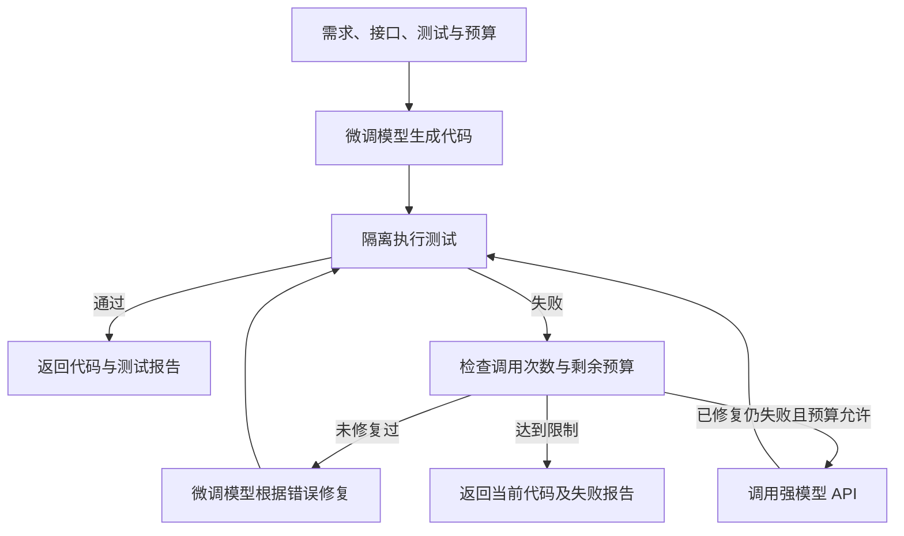
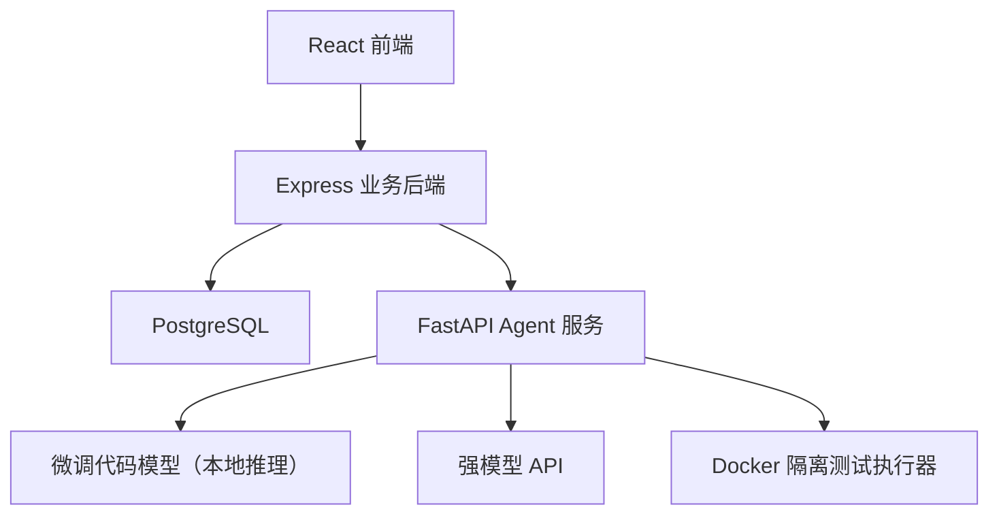

# 预算感知的 Python 代码生成与自动测试修复 Agent

英文名称：Budget-Aware Python Coding Agent with a Fine-Tuned Code Model and Test-Driven Repair  
课程：IERG4320 / IEMS5726A Data Science in Practice  
执行方式：个人独立完成  
方案日期：2026-10-13（同日修订：改为微调代码生成模型，取消路由模型训练）  
状态：已确认的设计方案。技术栈、数据库与界面语言约定已锁定；模型规模、具体型号和训练硬件待讨论。

本项目帮助用户在预算内完成 Python 函数编写。核心是自己微调的代码生成模型：它负责初次生成和根据测试错误修复；仍失败且预算允许时，再调用强模型 API。系统通过真实测试执行和有限轮次规则控制整个流程。当前方向取代之前的软件工单与会议提取方案，技术栈保持一致。

## 1 项目目标与第一版范围

研究目标：

1. 在预训练代码模型上做监督微调，能否提升其在 Python 单函数任务上的测试通过率。训练本身的贡献单独测量。
2. 在微调模型之上加入测试反馈修复和有限升级，能否在预算内进一步提高通过率，以及需要多少额外调用成本。

第一版范围：

- Python 单函数任务，需求和输入输出明确。
- 一个自己微调的代码生成模型（下称“微调模型”），基于预训练代码模型，必须实际完成训练。
- 一个强模型 API，仅作为失败后的升级手段，不参与训练。
- 修复与升级由显式规则控制；第一版不训练路由模型。
- 最多三次模型调用，同时受预算限制。
- 自动执行测试，根据错误信息修复或升级。
- 展示代码版本、测试结果、执行轨迹、调用费用及耗时。

创新探索集中于“自训代码模型 + 执行后验证 + 预算约束升级”的组合。相关方法已有研究，不直接宣称首次提出，收益通过对照实验验证。第一版不做任意仓库开发、复杂依赖安装或长期自主执行。

## 2 用户输入与结果

| 输入 | 内容 |
| --- | --- |
| 编程需求 | 功能及边界条件 |
| 函数接口 | 函数名、参数和返回要求 |
| 测试用例 | 输入与期望输出，优先使用结构化表单 |
| 执行偏好 | 优先省钱、均衡、优先质量 |
| 调用预算 | 允许的强模型调用费用上限 |

示例：返回列表中第二大的不同元素；不足两个不同元素时返回 None。

```python
assert second_largest([1, 3, 2]) == 2
assert second_largest([3, 3, 2]) == 2
assert second_largest([5, 5]) is None
```

结果包括代码、测试报告、未解决问题、调用次数、模型版本、token 用量、费用及耗时。测试通过仅表示通过当前检查，不保证程序对所有输入正确。

## 3 Agent 链路



| 步骤 | 行为 | 负责组件 |
| --- | --- | --- |
| 接收任务 | 校验需求、接口、测试及预算 | Express |
| 建立配置 | 确定输出规范、执行限制和调用上限 | Python Agent |
| 生成代码 | 微调模型推理，提取代码，记录 token 与耗时 | 本地模型适配器 |
| 执行测试 | 返回通过、失败、异常与超时 | 测试执行器 |
| 决策 | 接受、修复、升级或停止（规则） | Agent 控制器 |
| 升级 | 调用强模型 API，记录 token 与费用 | 强模型适配器 |
| 保存结果 | 持久化代码、轨迹、报告与费用 | Express 与 PostgreSQL |

规划阶段使用结构化配置，无需额外调用 LLM 生成计划。修复和升级时只提供原始需求、接口、反馈测试、当前代码及错误信息；隐藏测试永远不进入提示。

### 3.1 修复与升级规则

默认策略：微调模型初次生成 → 微调模型修复一次 → 仍失败且预算允许时调用强模型 → 停止。总调用上限三次。

| 结果 | 行动 |
| --- | --- |
| 反馈测试全部通过 | 接受结果 |
| 语法、接口、超时或测试失败，且尚未修复 | 将错误反馈给微调模型，修复一次 |
| 修复仍失败 | 预估费用不超过剩余预算时调用强模型 |
| 预算不足或次数耗尽 | 停止并展示失败报告 |
| 调用或执行组件异常 | 记录系统错误，有限重试，不混作代码错误 |

执行偏好只调整规则参数，不涉及训练（具体映射在实现前确认）：

| 偏好 | 规则 |
| --- | --- |
| 省钱 | 只用微调模型生成和修复，不调用强模型 |
| 均衡 | 默认策略 |
| 质量 | 微调模型初次失败后直接调用强模型，跳过本地修复 |

### 3.2 预算与执行约束

- 预算约束针对强模型 API 费用。微调模型本地推理不计 API 费用，但记录 token、耗时与硬件信息。
- 调用强模型前结合最大输出 token 保守预估费用，调用后记录实际用量。
- 估算与实际费用分别展示，不承诺未知用量下任意精度的硬预算。
- Python 在独立受限环境执行，设置超时、内存和进程限制，禁用网络，避免挂载凭据。
- 不依靠代码字符串过滤代替执行隔离。

## 4 技术栈与系统结构

| 层 | 技术 | 职责 |
| --- | --- | --- |
| 前端 | React、TypeScript、Vite | 输入、执行、代码及报告 |
| UI | Ant Design | 表单、列表与交互 |
| 图表 | ECharts | 通过率、成本与实验 |
| 后端 | Node.js、Express、TypeScript | 任务管理、查询、统计 |
| 数据库 | PostgreSQL | 任务、调用、代码版本、测试和反馈 |
| Agent | Python、FastAPI | 本地推理、强模型调用、验证、修复和升级 |
| 执行器 | Python 与 Docker 受限容器 | 运行代码及测试 |
| 训练 | PyTorch、Transformers（是否使用 PEFT/LoRA 视模型规模而定） | 代码生成模型微调 |
| 分析 | pandas | 数据处理及实验统计 |
| 部署 | Docker Compose | 组织服务和数据库 |



Express 创建任务后返回任务 ID，前端轮询进度。FastAPI 后台执行有限轮次流程，并按接口约定同步执行记录。第一版使用显式状态机，不引入 LangChain、LlamaIndex、AutoGen 等 Agent 框架。中断任务应标记失败或可重试，避免永久显示运行中。训练数据用 JSONL；模型权重与配置保存为模型文件；在线运行记录进 PostgreSQL。

## 4.1 界面与数据库语言约定

实现时遵守以下锁定约定，设计文档本身可用中文撰写。

前端所有用户可见文案使用英文，包括导航、表单、按钮、占位符、校验提示、状态、空态、加载、失败、预算耗尽提示，以及实验看板图例与轴标签。

| 页面（文档用语） | 界面英文名称 |
| --- | --- |
| 编程工作台 | Coding Workbench |
| 执行详情 | Run Details |
| 历史记录 | History |
| 实验看板 | Experiment Dashboard |

状态文案使用：`Running`、`Passed`、`Failed`、`Budget exhausted`、`System error`。执行偏好键存储为 `cheap`、`balanced`、`quality`。

数据库标识与系统写入值使用英文：

- 表名、列名、索引、外键：英文，例如 `tasks`、`model_calls`、`code_versions`、`test_runs`。
- 系统枚举与状态值：英文，例如 `pending`、`running`、`succeeded`、`failed`。
- 训练 JSONL 字段名：英文，并与在线库字段对齐。
- 主数据源 MBPP 的原始题目与测试为英文。
- 用户手输的 requirement 文本不做语言强制；系统生成的错误摘要、模型名与偏好键用英文存储。

PostgreSQL 本身无中文库或英文库之分。本约定指 schema 与系统写入内容使用英文，不使用中文列名或中文状态码。

## 5 简约莫兰迪前端

界面显示英文页面名称，见 4.1。下表为各页内容。

| 页面 | 内容 |
| --- | --- |
| Coding Workbench | 左侧需求、接口、测试、预算；右侧代码与结果 |
| Run Details | 每轮模型、代码版本、错误、修复和费用 |
| History | 查询、查看详情、重新运行 |
| Experiment Dashboard | 微调前后对比、训练曲线、修复与升级效果、成本与延迟 |

工作台提供可展开的执行时间线：微调模型生成 → 测试 2/3 通过 → 微调模型修复 → 测试通过。支持切换代码版本和比较改动。

| 用途 | 色值 | 风格 |
| --- | --- | --- |
| 页面背景 | #F4F2EF | 暖灰白 |
| 卡片 | #FCFBF9 | 米白 |
| 主色 | #73877B | 灰绿 |
| 辅助色 | #8192A3 | 灰蓝 |
| 失败提示 | #A66F66 | 灰砖红 |
| 正文 | #303936 | 深灰 |
| 边框 | #DDDCD6 | 浅暖灰 |

采用留白、细边框、轻阴影及统一圆角。状态由文字、图标和颜色共同表达；语法高亮优先保证可读性，最终检查对比度。包含加载、空数据、失败和预算耗尽状态。

## 6 数据集

### 6.1 数据来源

主数据使用 MBPP，必须从官方仓库原样下载文件（不能经网页抓取转换，否则代码缩进会被破坏）。

| 版本 | 题数 | 用途 |
| --- | --- | --- |
| 完整版 `mbpp.jsonl` | 974 | 训练与验证的主要来源 |
| 人工核验版 `sanitized-mbpp.json` | 427 | 需求描述更清晰，优先用于测试评估 |

两版共用 `task_id`，划分一律按 `task_id` 范围确定，保证同一题在两版中属于同一划分：

| task_id | 划分 | 完整版题数 | 用途 |
| --- | --- | --- | --- |
| 1-10 | prompt | 10 | 只作提示示例，不训练、不评估 |
| 11-510 | test | 500 | 只用于最终测试 |
| 511-600 | validation | 90 | 选择超参数、检查点和规则参数 |
| 601-974 | train | 374 | 训练 |

训练集规模较小。是否加入其他公开代码数据扩充训练集，在确定模型规模后讨论；加入任何外部数据前须排查其与 MBPP 测试题的重复。

预训练代码模型可能在预训练阶段见过 MBPP。由于实验比较的是同一模型微调前后的差异，该因素对前后两组相同；报告中仍需说明这一局限。

### 6.2 生成训练数据（第一版）

训练样本：“编程需求＋函数接口 → 正确参考代码”。

| 字段 | 含义 |
| --- | --- |
| task_id、split | 原始编号和数据划分 |
| requirement | 编程需求 |
| function_signature | 函数接口，从参考代码解析 |
| prompt | 按固定模板拼接的模型输入 |
| target_code | 参考代码（训练目标） |
| feedback_tests | 反馈测试，Agent 可见 |
| hidden_tests | 隐藏测试，只用于评估 |
| test_imports | 测试所需导入 |

数据准备步骤：

1. 下载官方原始文件，校验每题参考代码可解析，且能通过本题全部测试；不通过的题目记录原因后剔除。
2. 按 `task_id` 范围划分，划分固定后不再变动。
3. 用固定提示模板生成 `prompt`；推理与训练使用同一模板。
4. 分词后检查长度分布，确定最大长度，超长样本记录并处理。
5. 保存为 JSONL，并统计各划分的题数、长度与测试数量。

### 6.3 修复训练数据（扩展）

训练样本：“需求＋错误代码＋测试错误 → 修复后的正确代码”。

- 只从训练集题目构建：让基础模型或微调模型生成代码，在反馈测试上执行，收集失败的代码与错误信息，目标为参考代码。
- 验证集和测试集题目不得用于构建修复训练数据。
- 是否进入第一版，视生成训练完成情况决定。

### 6.4 反馈测试与隐藏测试

- 反馈测试对 Agent 可见，用于修复。
- 隐藏测试只用于最终评估，不进入任何提示，也不参与训练和调参。
- MBPP 每题通常只有 3 条测试，直接拆分后两类测试都很少。隐藏测试来源在 T4 讨论确定，候选方案：
  - 按条拆分原有测试（例如 1 条作反馈、其余作隐藏）；
  - 人工为测试集补充边界测试；
  - 引入公开的扩充测试集（如 EvalPlus 的 MBPP+），需核对题目对齐。
- 自动生成的测试经核验后才能用作评价标准。
- 分别报告反馈测试和隐藏测试通过率，避免只证明代码适配已知用例。

### 6.5 数据划分原则

- 训练集只用于参数更新；验证集用于选择超参数、检查点与规则参数；测试集只在最终评估时使用一次。
- 同一题的改写、不同模型回答和修复轨迹必须留在该题所属划分中。
- 演示用题目不从测试集中挑选做调参。

## 7 代码生成模型微调

### 7.1 模型

基于预训练代码模型做监督微调（因果语言模型）。模型规模、具体型号、全参数微调或 LoRA、训练硬件稍后讨论，暂不确定。确定时需考虑：训练显存、推理延迟（Agent 在线调用）、许可证，以及课程演示机器能否运行。

### 7.2 训练流程

训练循环使用 PyTorch 显式编写，必须包含以下环节：

| 环节 | 内容 |
| --- | --- |
| 数据准备 | 读取 JSONL，按模板构造输入，分词，填充或打包成批次 |
| 损失计算 | 因果语言模型交叉熵；提示部分标签置为忽略，只对 `target_code` 计算损失 |
| 反向传播 | `loss.backward()`，必要时梯度累积与混合精度 |
| 参数更新 | AdamW 优化器、学习率预热与衰减、梯度裁剪，`optimizer.step()` |
| 验证 | 每个周期计算验证集损失；按固定解码配置在验证集上生成代码并执行反馈测试，记录通过率 |
| 检查点选择 | 以验证集通过率（辅以验证损失）选择最佳检查点，可提前停止 |
| 测试 | 训练结束后只评估一次测试集，报告反馈测试与隐藏测试通过率 |
| 模型保存 | 保存最佳检查点的权重、分词器、训练配置、随机种子与指标 |

记录训练与验证损失曲线、学习率曲线、每周期验证通过率和训练耗时。固定随机种子，保证可复现。

### 7.3 推理与评估

- 解码配置（贪心或采样、温度、最大生成长度）固定，微调前后完全相同。
- 主指标 pass@1：生成一次，执行测试，全部通过记为成功。
- 从模型输出中提取第一个完整函数定义，提取失败记为失败。
- 生成代码在 Docker 受限容器中执行，复用在线 Agent 的执行器，保证离线评估与在线逻辑一致。

## 8 实验设计

实验分两层，先单独测量训练的贡献，再测量 Agent 机制的贡献。所有结果在测试集上报告，参数只用验证集选择。

### 8.1 训练贡献（单次生成，无修复无升级）

| 编号 | 配置 | 目的 |
| --- | --- | --- |
| E1 | 基础模型（微调前） | 基线 |
| E2 | 微调模型 | 与 E1 对比得到训练本身的贡献 |

E1 与 E2 使用同一模型、同一提示模板、同一解码配置和同一测试题，唯一差别是是否经过微调。

### 8.2 Agent 机制贡献

| 编号 | 配置 | 目的 |
| --- | --- | --- |
| E3 | 基础模型＋修复 | 修复对未微调模型的作用 |
| E4 | 微调模型＋修复 | 修复的增量贡献 |
| E5 | 微调模型＋修复＋强模型升级 | 完整 Agent |
| E6 | 只用强模型（单次） | 质量与成本参考 |
| E7 | 基础模型＋修复＋强模型升级（可选） | 区分完整系统中训练的贡献 |

对比尽量采用相同预算、调用上限和反馈测试；单次调用对照明确标为消融。

### 8.3 指标与图表

指标：反馈测试与隐藏测试 pass@1、修复成功率、升级率、平均调用次数、强模型实际费用、token、推理与总延迟；训练侧记录训练/验证损失与验证通过率。

图表：数据分布、训练与验证曲线、E1 与 E2 对比、各配置通过率与成本对比、预算—质量曲线、典型执行轨迹。不预设微调或升级一定带来提升，结果如实报告。

## 9 单人任务顺序

| 阶段 | 任务 | 验收标准 | 状态 |
| --- | --- | --- | --- |
| T1 数据与接口打样 | 少量 MBPP 题、固定字段和测试格式 | 一题数据完整，测试可执行 | 已完成（原始数据已改为官方原样文件） |
| T2 核心原型 | 生成、测试、修复、升级和预算的命令行闭环 | 命令行跑通完整任务 | 已完成（mock 模型，按新链路与偏好规则） |
| T3 最小网页 | FastAPI、Express、数据库及工作台 | 浏览器运行任务 | 已完成（mock 模型，按新链路更新） |
| T4 训练数据准备 | 原样下载 MBPP、校验、固定划分、提示模板、分词与长度统计、隐藏测试方案 | 三个划分的 JSONL 可追溯，统计完整 | 待开始 |
| T5 模型选择与基线评估 | 确定模型、规模与硬件；评估基础模型（E1） | 基础模型在验证集和测试集上的 pass@1 | 待讨论 |
| T6 微调训练 | 训练循环、验证、检查点选择、测试评估、模型保存（E2） | 训练曲线、最佳检查点与 E1/E2 对比 | 待开始 |
| T7 Agent 接入 | 本地模型适配器、强模型 API 适配器，替换 mock；修复与升级规则 | 网页上用微调模型跑通真实任务 | 待开始 |
| T8 实验 | E3 至 E7，修复训练扩展（可选） | 实验表格与图表完整 | 待开始 |
| T9 产品完善 | 历史、详情、版本比较、实验看板和样式 | 页面完整 | 待开始 |
| T10 课程交付 | 部署、报告、视频、代码包 | 可复现且符合要求 | 待开始 |

T4 可立即开始。T5 需先讨论模型与硬件。T6 训练期间可并行推进 T7 的强模型适配器和 T9 页面。

### 进度清单

- [x] 确认技术栈、PostgreSQL、显式状态机，以及前端英文与数据库英文标识约定。
- [x] 检查 MBPP 字段、划分和测试（已用官方原样文件重新核验）。
- [x] 用少量题目完成样本格式（已按 6.2 字段调整，`prompt` 待 T4 确定模板）。
- [x] 实现 Docker 受限执行器。
- [x] 跑通命令行生成、测试、修复和预算（mock 模型）。
- [x] 连接 FastAPI、Express、PostgreSQL。
- [x] 完成最小工作台及进度查询（mock 模型）。
- [x] 按新链路调整控制器、偏好规则、文案与数据库字段。
- [x] 原样下载 MBPP 官方文件（`mbpp.jsonl` 与 `sanitized-mbpp.json`）。
- [ ] 构建固定划分的训练、验证、测试 JSONL。
- [ ] 确定隐藏测试方案。
- [ ] 确定基础模型、规模、微调方式与训练硬件。
- [ ] 评估基础模型（E1）。
- [ ] 完成微调训练、验证、测试与模型保存（E2）。
- [ ] 接入本地模型适配器与强模型 API 适配器。
- [ ] 完成 E3 至 E7 实验。
- [ ] 修复训练扩展（可选）。
- [ ] 完成历史、详情、实验看板和视觉设计。
- [ ] 验证超时、预算耗尽、系统异常和中断。
- [ ] 完成部署、报告、视频及提交包。

## 10 课程交付

报告包括问题定义、数据处理与表示、模型训练、可视化、架构与界面、最多四项挑战、参考资料、AI 工具声明及签署 VeriGuide receipt。

代码 ZIP/RAR 按课程要求包含 source_code 与 application；训练模型提供下载链接，不放进压缩包。视频单独提交，不超过十分钟，超过一半时间用于实际操作演示。截止日期为 2026-12-17，具体时间与提交入口以 Blackboard 为准。

学习式路由、更多模型、其他语言、多任务分解和仓库级开发属于扩展项，第一版完成后再考虑。

## 11 参考与下一步

- MBPP：https://github.com/google-research/google-research/tree/master/mbpp
- MBPP 说明：https://raw.githubusercontent.com/google-research/google-research/master/mbpp/README.md
- MBPP 论文：Austin et al., Program Synthesis with Large Language Models, 2021
- EvalPlus（MBPP+ 扩充测试）：https://github.com/evalplus/evalplus
- 课程依据：用户提供的项目说明 PDF 与报告 Word 模板。

下一步：开始 T4 训练数据准备（提示模板、隐藏测试方案、完整版 180 与 493 两题的处理），并讨论 T5 的模型规模、型号与训练硬件。
